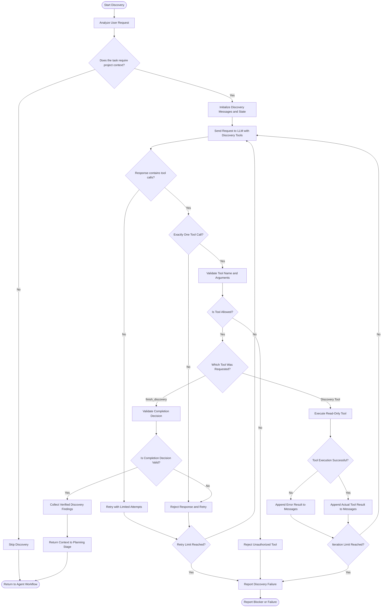

# Project Discovery Flow

## Purpose

Discover sufficient, verified project context before generating an implementation plan. Discovery is read-only and must not modify project files.

## Flowchart

## Discovery Rules

1. Inspect the workspace before assuming any file exists.
2. Use the actual paths returned by the project inventory.
3. Make at most one tool call per LLM response.
4. Execute only registered, permitted, read-only discovery tools.
5. Append tool results to the conversation before requesting the next decision.
6. Treat failed tool execution as an error, not evidence that a file does not exist.
7. Stop successfully only when the LLM explicitly calls `finish_discovery` and the application accepts the completion decision.
8. Enforce a maximum iteration count and a limited retry policy.
9. Never treat ordinary assistant text or an empty response as successful completion.
10. Preserve verified findings and clearly identify unresolved uncertainties.

## Completion Conditions

### Successful completion

The LLM calls `finish_discovery` with a meaningful reason, and the application validates the decision against the gathered evidence.

The application returns the discovered context to the planning stage.

### Discovery failure

Discovery fails when the retry or iteration limit is reached, a tool call is invalid, or essential information cannot be obtained.

The application must report the failure or blocker rather than silently generating a plan from insufficient evidence.

## Responsibilities

| Component | Responsibility |
|---|---|
| Requirement Analyzer | Determines whether project context is needed. |
| Discovery LLM | Selects the next discovery action or requests completion. |
| Tool Registry | Exposes permitted discovery tools. |
| Tool Executor | Executes validated discovery tools. |
| Discovery Controller | Enforces tool-call limits, retries, and termination. |
| Discovery State | Records verified tool results and relevant findings. |
| Planner | Generates the implementation plan after successful discovery. |

## Important Design Principle

The LLM proposes the next action. The application controls execution, validates results, and enforces termination rules.

A completion claim must be grounded in actual tool results. The LLM must not invent files, routes, dependencies, tests, or implementation details.
