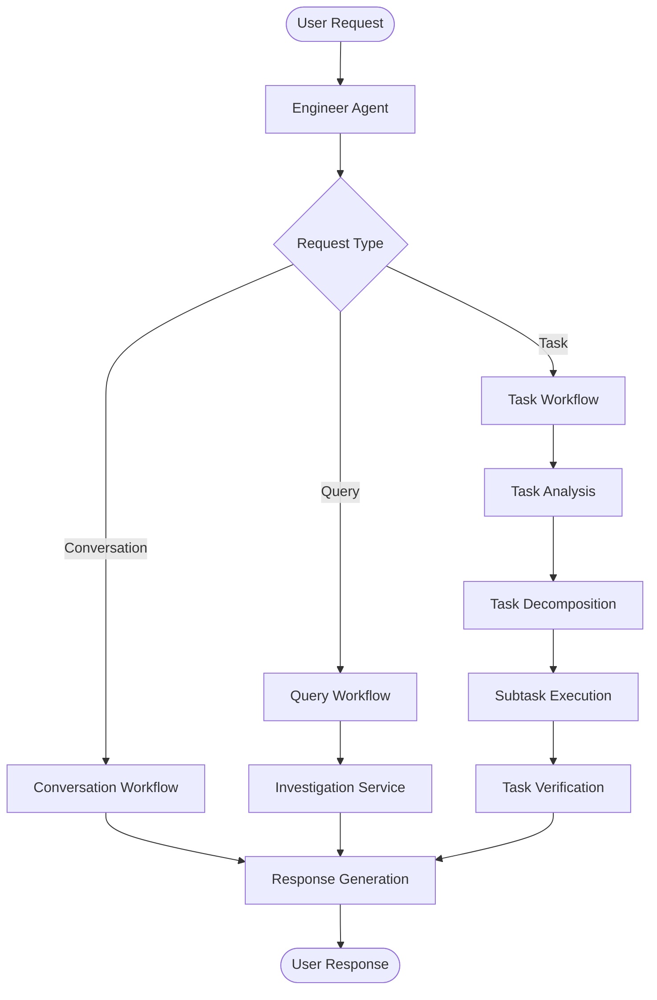
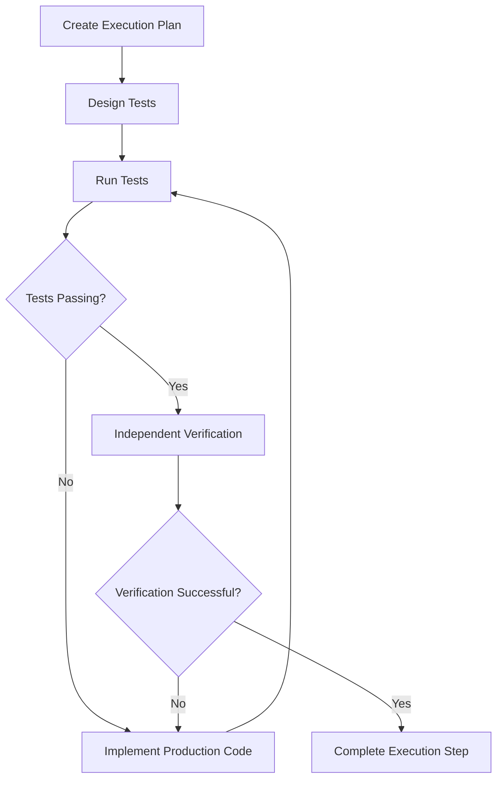

# AI Senior Backend Engineer Agent

An AI-powered autonomous software engineering agent designed to understand, investigate, plan, and execute backend development tasks within an existing codebase.

The system uses specialized AI agents, workflow orchestration, and MCP-based tools to perform software engineering activities while following existing project architecture, coding conventions, and development practices.

The initial focus is on TypeScript backend development.

## Overview

The AI Senior Backend Engineer Agent aims to automate the software development lifecycle through specialized agents and structured workflows.

Instead of relying on a single LLM to perform every activity, the system separates responsibilities across multiple agents.

Each agent focuses on a specific engineering responsibility, while workflows coordinate their execution and manage the overall lifecycle.

### Key Features

- **Request Classification:** Understands user requests and routes them to the appropriate workflow.
- **Codebase Investigation:** Inspects existing projects using MCP tools and gathers implementation context.
- **Task Analysis:** Analyzes requirements, expected outcomes, and acceptance criteria.
- **Task Decomposition:** Breaks complex development tasks into manageable subtasks.
- **Execution Planning:** Generates ordered execution plans for individual subtasks.
- **Test-Driven Development:** Follows a test-first development approach.
- **Automated Implementation:** Uses specialized agents to implement production code.
- **Code Review:** Reviews implementation against requirements and coding standards.
- **Task Verification:** Validates completed work through automated tests and final code review.
- **Conversation History:** Maintains interaction history across workflows.
- **Human Approval:** Supports approval policies for operations that require authorization.

## Architecture

The system follows a layered architecture inspired by Domain-Driven Design (DDD) and Clean Architecture principles.

```text
agent/
├── domain/
│   ├── entities/
│   ├── vo/
│   ├── repository/
│   └── policy/
│
├── application/
│   ├── agents/
│   ├── services/
│   ├── port/
│   └── workflows/
│
├── infrastructure/
│   ├── llm/
│   ├── mcp/
│   ├── persistence/
│   ├── prompt/
│
└── interface/
    └── cli/
```

### Architectural Principles

- **Domain:** Contains core business concepts, entities, value objects, and domain policies.
- **Application:** Coordinates agents, services, workflows, and application use cases.
- **Infrastructure:** Provides concrete implementations for LLMs, MCP clients, persistence, and external integrations.
- **Interface:** Handles user interaction and application initialization.

The application layer depends on abstractions rather than infrastructure implementations. Concrete dependencies are wired through the composition root.

## Workflow Architecture

The EngineerWorkflow acts as the main entry point and classifies incoming user requests.

Three primary workflows handle different request types:

| Workflow | Responsibility |
|---|---|
| ConversationWorkflow | Handles general conversational requests |
| QueryWorkflow | Investigates and retrieves information from existing projects |
| TaskWorkflow | Coordinates the complete software development lifecycle |

### High-Level Request Flow



## Task Execution Lifecycle

TaskWorkflow manages the complete development lifecycle.

### 1. Task Analysis

TaskAnalysisAgent analyzes the user request and identifies:

- Functional requirements.
- Expected outcomes.
- Acceptance criteria.
- Missing information.
- Open questions requiring clarification.
- Investigation requirements.

InvestigationService is invoked when additional codebase context is required.

### 2. Task Decomposition

TaskDecompositionAgent breaks the complete task into smaller implementation subtasks.

Each subtask represents a meaningful development responsibility with a clearly defined outcome.

### 3. Subtask Execution

SubtaskExecutionWorkflow handles one subtask at a time.

It is responsible for:

- Creating an execution plan.
- Executing individual plan steps.
- Coordinating specialized engineering agents.
- Handling execution feedback.
- Tracking execution progress.

The execution plan follows a test-driven development approach.

### 4. Test-Driven Development

The execution process follows this sequence:



Specialized agents:

| Agent | Responsibility |
|---|---|
| TestDesignAgent | Designs and writes automated tests |
| TestRunAgent | Executes tests and reports results |
| CodeImplementationAgent | Implements production code |
| CodeReviewAgent | Reviews implementation |

### 5. Task Verification

After all subtasks have been executed, TaskVerificationWorkflow validates the complete task.

It performs:

- Full test suite execution.
- Acceptance criteria verification.
- Final code review.
- Identification of remaining issues.

TaskWorkflow uses the verification result to determine whether the task is complete or further work is required.

## Investigation Architecture

InvestigationService provides reusable codebase investigation capabilities.

It can be used by both QueryWorkflow and TaskWorkflow.

The Investigation Agent:

- Understands the investigation objective.
- Inspects relevant project files.
- Identifies existing implementations and architectural patterns.
- Gathers evidence.
- Identifies gaps, dependencies, and risks.
- Returns structured investigation findings.

The agent operates in read-only mode.

## MCP Tool Integration

The system uses the Model Context Protocol (MCP) to interact with external tools.

MCP tools provide capabilities such as:

- Project inspection.
- File listing and reading.
- Code search.
- Project command execution.
- File creation and modification.

### Tool Execution Responsibilities

| Component | Responsibility |
|---|---|
| MCPClient | Communicates with MCP servers |
| ToolCatalogService | Discovers and manages available tools |
| ToolAccessPolicy | Controls agent-specific tool permissions |
| ToolApprovalPolicy | Determines whether an operation requires approval |
| ToolExecutionService | Coordinates authorization, approval, execution, and history |

Tool access is restricted according to agent responsibilities. For example, the Investigation Agent receives read-only capabilities, while implementation agents may receive additional permissions.

## Conversation Management

The system maintains a unified conversation across all workflows.

Conversation history includes:

- User messages.
- Assistant messages.
- Agent responses.
- Tool calls.
- Tool execution results.

Tool interactions are persisted as they occur, allowing the system to reconstruct execution history and maintain context.

The ResponseGenerationService uses workflow results and relevant conversation context to generate the final user-facing response.

## Technology Stack

| Technology | Purpose |
|---|---|
| Python | Agent runtime and application orchestration |
| TypeScript | Target backend development language |
| Ollama | Local LLM execution |
| FastMCP / MCP | Tool integration |
| Pydantic / JSON Schema | Structured data and response validation |
| Docker | Containerized infrastructure |
| uv | Python dependency and project management |

*Adjust this list to match the dependencies currently used in the project.*

## Design Principles

The system is being developed around the following principles:

1. **Specialized Agents:** Each agent has a clearly defined responsibility.
2. **Workflow Orchestration:** Workflows control execution rather than individual agents coordinating each other.
3. **Separation of Concerns:** Reasoning, orchestration, tool execution, and persistence remain separate.
4. **Domain-Driven Design:** Core concepts and business rules are independent of external technologies.
5. **Evidence-Based Investigation:** Codebase findings must be supported by actual project evidence.
6. **Test-Driven Development:** Production implementation follows test design.
7. **Controlled Tool Execution:** Agent permissions and approval policies govern tool usage.
8. **Human Oversight:** Operations requiring approval must respect authorization boundaries.

## Project Status

This project is under active development.

The architecture is being developed incrementally, with an initial focus on:

- Agent orchestration.
- Request classification.
- Investigation capabilities.
- Task analysis and decomposition.
- Subtask execution planning.
- MCP tool integration.
- Test-driven implementation and verification.

Not all planned capabilities are necessarily implemented yet.

## Future Improvements

Potential areas of future development include:

- Dependency-aware and parallel subtask execution.
- Persistent workflow recovery and resumability.
- Advanced RAG-based codebase context retrieval.
- Improved execution planning and validation.
- More sophisticated approval and security policies.
- Support for additional programming languages and frameworks.
- Execution observability and workflow monitoring.

